# Руководство пользователя — OptimNet

OptimNet — десктопное приложение (Python ≥ 3.10, PyQt6) для оптимизации живучести
компьютерной сети. Методика, модель и обозначения — в [`optim.md`](optim.md);
архитектура и устройство кода — в [`developer_guide.md`](developer_guide.md).
Настоящий документ описывает работу с программой с точки зрения пользователя:
устройство интерфейса, порядок настройки задачи, типовые сценарии использования
с реальными результатами прогонов и форматы обмена данными.

## 1. Назначение и область применения

OptimNet решает задачу повышения живучести компьютерной сети как задачу
оптимизации. Сеть моделируется взвешенным ориентированным графом
G = ⟨V, E, C, W⟩, где V — множество узлов (маршрутизаторов, коммутаторов,
серверов), E — множество каналов связи, C = {c_ij} — их ёмкости, W — весовые
характеристики (стоимость, задержка, надёжность). Состояние сети описывается
вектором структурных параметров x = (x_1, …, x_N), где каждый x_k — дискретная
переменная (выбор резервного канала) и/или непрерывная (объём резервирования).

Воздействие дестабилизирующих факторов моделируется набором сценариев s с
вероятностями p(s). Качество функционирования Q(x, s) оценивается в каждом
сценарии, а живучесть вычисляется как

Ψ(x) = Σ p(s)·φ(Q(x, s)),  где φ(Q) = 1 при Q ≥ Q_min и 0 при Q < Q_min.

В приложении реализованы частные постановки из optim.md:

- **5.1 — максимизация живучести при бюджете**: Ψ(x) → max при C_Σ(x) ≤ C_бюдж
  и Q(x, s) ≥ Q_min для всех сценариев;
- **5.2 — минимизация стоимости при требовании живучести**: C_Σ(x) → min при
  Ψ(x) ≥ Ψ_треб и λ_ab(x, s) ≥ r_ab для приоритетных пар (a, b);
- **5.3 — робастная (минимакс)**: максимизация min Q(x, s) по критическим
  сценариям;
- **аддитивная свёртка критериев (п. 6)**: Φ(x) = Σ α_k·F̃_k(x) → max по
  нормированным критериям живучести, стоимости, времени восстановления и
  среднего качества с весами α_k.

Задача относится к классу NP-трудных задач дискретно-непрерывной стохастической
оптимизации, поэтому в OptimNet используются эвристические и метаэвристические
алгоритмы: генетический алгоритм, имитация отжига, метод ветвей и границ (точный,
для малых экземпляров постановки 5.1) и жадная эвристика.

**Область применения.** Проектирование и аудит отказоустойчивых сетей: выбор
оптимального набора резервных каналов при заданном бюджете, оценка живучести
проектных решений, сравнение алгоритмов оптимизации на одном наборе данных.
Приложение рассчитано на инженеров-исследователей и не предполагает
программирования: весь цикл «топология → сценарии → постановка → алгоритм →
результат» выполняется в графическом интерфейсе.

Общая схема работы приложения:

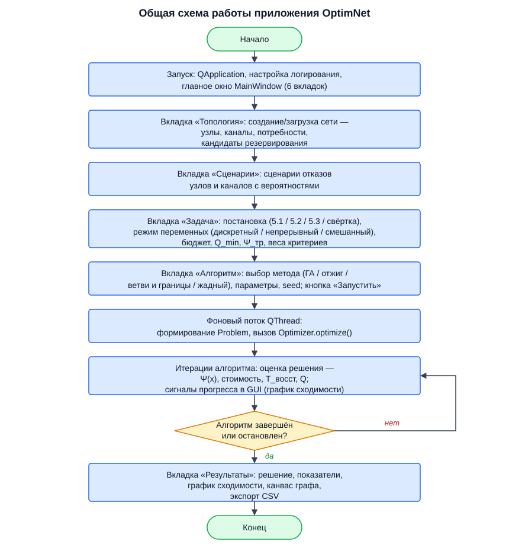

### 1.1. Обзор возможностей

- Ручной ввод и редактирование топологии (узлы, каналы, потребности, кандидаты
  на резервирование) в таблицах с немедленной визуализацией графа.
- Загрузка/сохранение примеров в JSON, импорт/экспорт топологии в CSV-каталоге,
  три встроенных демо-примера (6, 10 и 20 узлов).
- Редактор сценариев поражения (отказы узлов и каналов, вероятности) и
  генератор случайных сценариев с заданными вероятностями отказа.
- Четыре постановки задачи, два варианта качества Q(x, s) (максимальный поток
  или связность), три режима переменных (дискретный, непрерывный, смешанный),
  настраиваемые пороги Q_min, Ψ_треб, бюджет, штраф M и веса свёртки α_k.
- Запуск одного алгоритма или сравнительный эксперимент «несколько алгоритмов ×
  несколько прогонов с разными seed» без блокировки интерфейса, с индикатором
  прогресса и возможностью остановки.
- Таблицы результатов (решение x, значения Ψ, C_Σ, T_восст, Q̄, проверка
  допустимости и нарушений, качество по сценариям), график сходимости,
  выделение резервных каналов на графе сети, экспорт результатов в CSV и JSON.

### 1.2. Требования и запуск

Требования: Python ≥ 3.10 и пакеты из `requirements.txt` — PyQt6 ≥ 6.5,
numpy ≥ 1.24, networkx ≥ 3.0, matplotlib ≥ 3.7 (pytest нужен только для
запуска тестов). Операционная система — любая десктопная, поддерживаемая Qt
(Windows, Linux, macOS).

Установка зависимостей и запуск из каталога проекта:

```
pip install -r requirements.txt
python main.py
```

При старте открывается главное окно (1200×800) с загруженным по умолчанию
примером `examples/medium.json` (сеть из 10 узлов, 9 сценариев). Ход работы
приложения записывается в журнал `optimnet.log` в каталоге проекта и
дублируется в консоль.

## 2. Графический интерфейс

### 2.1. Главное окно: вкладки, меню, строка статуса

Заголовок окна: «OptimNet — оптимизация живучести компьютерной сети». Центральную
часть занимает панель из шести вкладок: **«Топология»**, **«Сценарии»**,
**«Задача»**, **«Алгоритм»**, **«Эксперимент»**, **«Результаты»**. Переключение
вкладок обновляет их содержимое из общего состояния приложения.

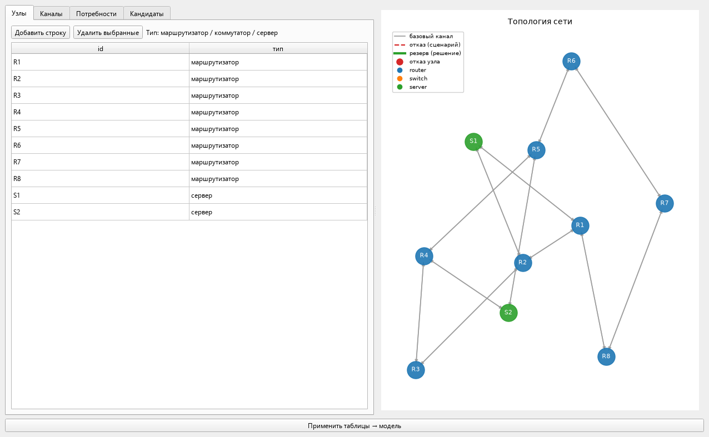

Меню **«Файл»**:

| Пункт | Горячая клавиша | Назначение |
|---|---|---|
| Открыть пример (JSON)… | Ctrl+O | Загрузка файла примера: топология + сценарии в одном JSON. После загрузки бюджет автоматически предлагается равным 0.5 · Σ стоимостей кандидатов. |
| Сохранить пример (JSON)… | Ctrl+S | Сохранение текущей топологии и сценариев в файл JSON. |
| Импорт топологии (CSV-каталог)… | — | Чтение топологии из набора CSV-файлов (`nodes.csv`, `links.csv`, `demands.csv`, `candidates.csv`) в выбранном каталоге. |
| Экспорт топологии (CSV-каталог)… | — | Запись топологии в указанный каталог CSV-файлами. |
| Демо-примеры → Малый (6 узлов) | — | Построение встроенной малой сети (аналог `examples/small.json`). |
| Демо-примеры → Средний (10 узлов) | — | Построение встроенной средней сети (аналог `examples/medium.json`). |
| Демо-примеры → Большой (20 узлов) | — | Построение встроенной большой сети (аналог `examples/large.json`). |
| Выход | Ctrl+Q | Завершение работы приложения. |

Меню **«Справка»** содержит единственный пункт «О программе» (см. п. 2.10).

**Строка статуса** (внизу окна) показывает сводку по текущим данным:

```
узлов: 10  |  каналов: 24  |  кандидатов: 6  |  сценариев: 9  |  Σp(s) = 1.000
```

Здесь и далее Σp(s) — сумма вероятностей сценариев; для корректной интерпретации
Ψ как математического ожидания она должна быть равна 1.

### 2.2. Вкладка «Топология»

Вкладка разделена вертикальным разделителем: слева — четыре вложенные вкладки
с редактируемыми таблицами, справа — канвас графа (см. п. 2.3).

Каждая таблица поддерживает выделение строк целиком и редактирование ячеек
«в месте». Над каждой таблицей — кнопки **«Добавить строку»** (добавляет
пустую строку) и **«Удалить выбранные»** (удаляет выделенные строки), а также
подсказка о формате данных.

**«Узлы»** — узлы сети.

| Колонка | Формат | Допустимые значения |
|---|---|---|
| id | текст | Уникальный идентификатор узла, например R1, S1. |
| тип | текст | `маршрутизатор` / `коммутатор` / `сервер` (отображаются на русском; в файлах хранятся как router/switch/server). |

Подсказка: «Тип: маршрутизатор / коммутатор / сервер». Тип влияет на цвет
вершины на канвасе.


**«Каналы»** — ориентированные каналы базовой топологии.

| Колонка | Формат | Значение по умолчанию при пустом поле |
|---|---|---|
| источник | id узла | — |
| назначение | id узла | — |
| ёмкость | число ≥ 0 (допускается запятая) | 0 |
| стоимость | число | 1.0 |
| задержка | число | 0 |
| надёжность | число 0…1 | 0.99 |

Подсказка: «Ориентированные каналы базовой топологии». Для двусторонней связи
задаются два канала (например, R1→R2 и R2→R1).

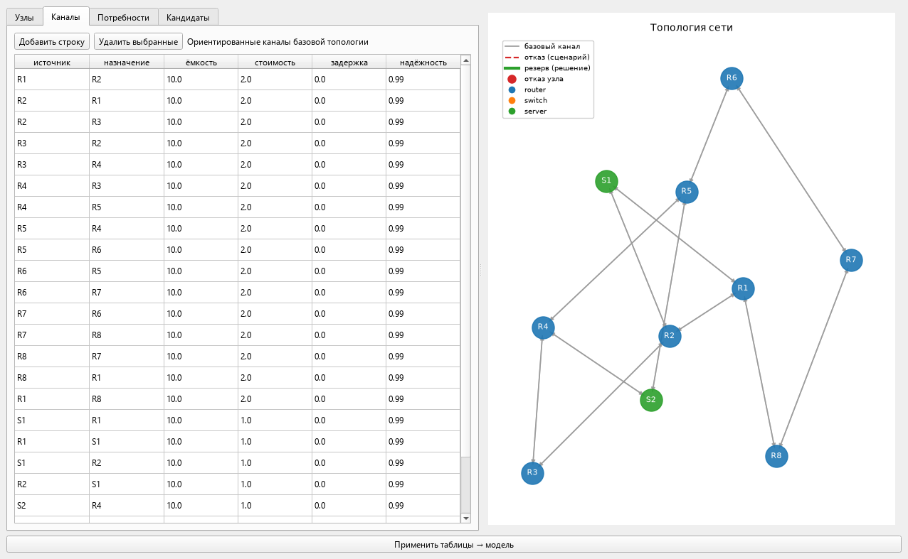

**«Потребности»** — пары узлов с трафиком.

| Колонка | Формат | Значение по умолчанию |
|---|---|---|
| источник | id узла | — |
| назначение | id узла | — |
| объём | число > 0 | 1.0 |

Подсказка: «Пары узлов с трафиком (Q = доля доставленного)». Потребности
определяют вариант качества «доля доставленного трафика (макс. поток)» и
множество приоритетных пар для варианта «связность».

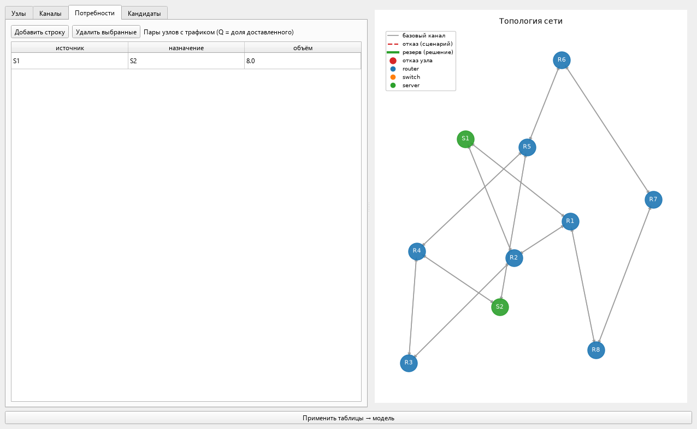

**«Кандидаты»** — возможные резервные каналы; именно по ним строится вектор
решения x.

| Колонка | Формат | Значение по умолчанию |
|---|---|---|
| id | текст | — |
| источник | id узла | — |
| назначение | id узла | — |
| ёмкость | число > 0 | 0 |
| стоимость | число > 0 | 1.0 |

Подсказка: «Возможные резервные каналы (переменные x)». Кандидат может
совпадать по паре узлов с базовым каналом — тогда резервирование увеличивает
его ёмкость.

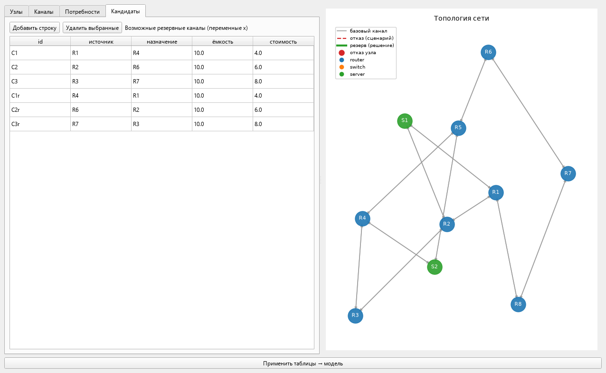

Кнопка **«Применить таблицы → модель»** под разделителем переносит содержимое
всех четырёх таблиц во внутреннюю модель сети. Перед применением выполняется
проверка: каждый канал, потребность и кандидат должен ссылаться на известные
узлы. При ошибке показывается предупреждение «Ошибка топологии» с текстом
(например, «Канал ('R1', 'X9'): неизвестный узел»), модель не меняется.
После успешного применения граф на канвасе перерисовывается, а прежние
результаты оптимизации сбрасываются. Порядок работы: сначала отредактируйте
таблицы, затем нажмите «Применить таблицы → модель».

### 2.3. Канвас графа

Канвас (справа на вкладке «Топология») рисует сеть средствами matplotlib.
Размещение вершин — пружинная раскладка (алгоритм Фрухтермана–Рейнгольда,
фиксированный seed = 42); раскладка пересчитывается заново при изменении
набора узлов. При пустой модели на канвасе выводится подсказка «Нет данных:
загрузите пример или задайте топологию».

Обозначения (дублируются легендой в левом верхнем углу):

- **Узлы** — круги диаметром, пропорциональным константе 500; цвет по типу:
  синий `#1f77b4` — маршрутизатор (router), оранжевый `#ff7f0e` — коммутатор
  (switch), зелёный `#2ca02c` — сервер (server). Подписи узлов — белым цветом.
- **Базовые каналы** — серые стрелки (`#999999`).
- **Отказавшие каналы выбранного сценария** — красные пунктирные стрелки
  (`#d62728`).
- **Отказавшие узлы сценария** — красная кайма вокруг вершины.
- **Резервные каналы найденного решения** — зелёные утолщённые стрелки; толщина
  растёт с объёмом резервирования (1.5 + 2.5·min(объём, 1)), рядом со стрелкой
  зелёным подписан объём (две цифры после запятой). Если резервная пара узлов
  совпала с отказавшим каналом сценария, стрелка рисуется красным пунктиром.
- Заголовок рисунка — «Топология сети» или заданный (например, при показе
  решения: «Резервные каналы — Генетический алгоритм»).

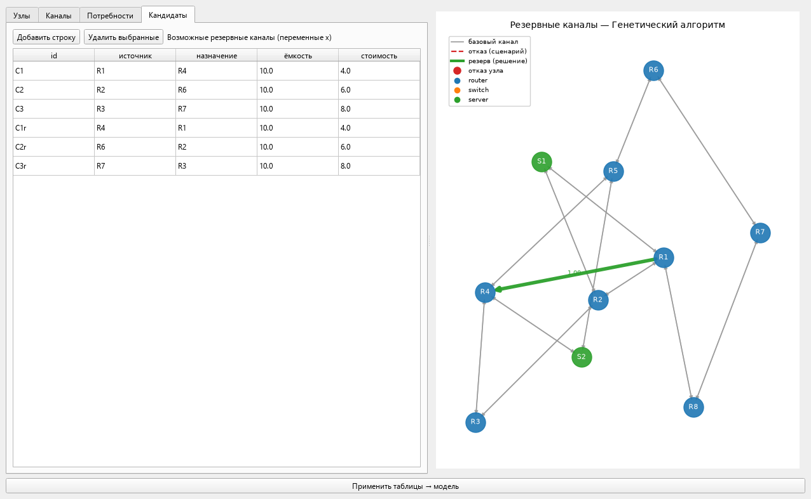

Решение на канвас выводится кнопкой «Показать решение на графе» со вкладки
«Результаты» (см. п. 2.8): приложение переключается на вкладку «Топология»,
а на канвасе поверх базовой топологии зелёным выделяются выбранные решением
резервные каналы с объёмами.

### 2.4. Вкладка «Сценарии»

Вкладка состоит из списка сценариев (слева) и панели управления (справа).

**Список сценариев.** Каждый элемент показывается как «id (p=….)» — например,
`S1  (p=0.0750)`. Выбор строки загружает сценарий в редактор. Клик по кнопке
**«Новый сценарий»** добавляет сценарий с id вида S{N} и вероятностью 0;
кнопка **«Удалить»** убирает выбранный сценарий.

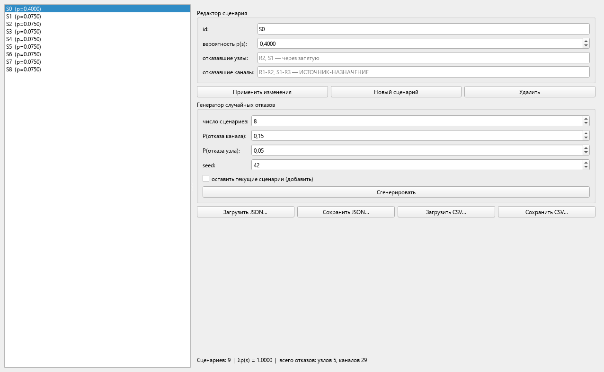

**Группа «Редактор сценария»** — редактирование выбранного сценария:

| Поле | Тип | Диапазон/формат |
|---|---|---|
| id: | строка ввода | Произвольный текст; пустое значение сохраняет прежний id. |
| вероятность p(s): | число с плавающей точкой | 0.0…1.0, шаг 0.05, 4 знака после запятой. |
| отказавшие узлы: | строка ввода | Список id через запятую (допускается «;»), подсказка в поле: «R2, S1 — через запятую». |
| отказавшие каналы: | строка ввода | Пары «ИСТОЧНИК-НАЗНАЧЕНИЕ» через запятую, подсказка: «R1-R2, S1-R3 — ИСТОЧНИК-НАЗНАЧЕНИЕ». |

Кнопка **«Применить изменения»** записывает поля редактора в сценарий. Если
формат отказавших каналов нарушен (нет символа «-» в элементе списка),
показывается предупреждение «Канал '…': ожидается формат
ИСТОЧНИК-НАЗНАЧЕНИЕ».

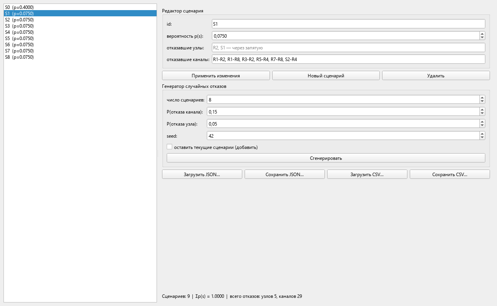

**Группа «Генератор случайных отказов»** — автоматическое построение сценариев:

| Поле | Диапазон | По умолчанию |
|---|---|---|
| число сценариев: | 1…500 | 8 |
| P(отказа канала): | 0.0…1.0, шаг 0.01 | 0.15 |
| P(отказа узла): | 0.0…1.0, шаг 0.01 | 0.05 |
| seed: | 0…999999 | 42 |
| флажок «оставить текущие сценарии (добавить)» | — | снят |

Кнопка **«Сгенерировать»** строит заданное число случайных сценариев: каждый
канал отказывает с вероятностью P(отказа канала), каждый узел — с вероятностью
P(отказа узла); штатный режим (без отказов) не генерируется. Если флажок
«оставить текущие сценарии (добавить)» **снят**, список сценариев заменяется
на штатный сценарий S0 (p = 0.4, без отказов) плюс сгенерированные, вероятности
которых перенормируются до суммы 0.6 (то есть 0.6/число сценариев каждый).
Если флажок **установлен**, сгенерированные сценарии добавляются к текущим с
вероятностями 1/число сценариев. Генератор требует заданной топологии: без
узлов показывает предупреждение «Сначала задайте топологию сети.».

**Файловые кнопки**: «Загрузить JSON…», «Сохранить JSON…», «Загрузить CSV…»,
«Сохранить CSV…» — импорт/экспорт только сценариев (структуры файлов — в разделе 5).

Внизу панели — сводка: «Сценариев: N | Σp(s) = …. | всего отказов: узлов …,
каналов …».

### 2.5. Вкладка «Задача»

Вкладка задаёт параметры постановки (сохраняются в конфигурацию кнопкой
«Применить к конфигурации задачи»).

**Группа «Постановка задачи»** — три выпадающих списка:

| Поле | Варианты |
|---|---|
| постановка: | «5.1 — максимизация Ψ при бюджете» (max_survivability); «5.2 — минимизация стоимости при Ψ ≥ Ψ_треб» (min_cost); «5.3 — робастная (минимакс по сценариям)» (minimax); «6 — аддитивная свёртка критериев» (scalarized) |
| качество Q(x,s): | «доля доставленного трафика (макс. поток)» (flow); «связность критических пар» (connectivity) |
| переменные: | «дискретный (выбор резервных каналов)»; «непрерывный (объёмы резервирования)»; «смешанный (каналы + объёмы)» |

В дискретном режиме переменная x_k ∈ {0, 1} означает «кандидат k включён/
выключен» (объём резервирования равен 1); в непрерывном — все кандидаты
включены, и оптимизируются объёмы x_k ∈ [0, 1]; в смешанном режиме
оптимизируются и выбор, и объёмы. Режим влияет на список доступных алгоритмов
(см. п. 2.6).

**Группа «Параметры»**:

| Поле | Подпись | Диапазон | По умолчанию |
|---|---|---|---|
| Q_min (порог φ): | минимально допустимое качество | 0.0…1.0 | 0.8 |
| C_бюдж (бюджет): | бюджетное ограничение C_Σ ≤ C_бюдж | 0.0…1e9 | 50.0 (при загрузке примера подставляется 0.5 · Σ стоимостей кандидатов) |
| Ψ_треб (для 5.2): | требуемая живучесть для постановки 5.2 | 0.0…1.0 | 0.9 |
| t_ед (время восст.): | параметр модели времени восстановления T_восст | 0.0…1e6 | 1.0 |
| штраф M: | коэффициент штрафа за нарушения ограничений | 0.0…1e9 | 10.0 |

Целевая функция любой постановки вычисляется как F = F_raw − M·Σ(нарушений²):
нарушение бюджета (C_Σ > C_бюдж), дефицит качества (Q(x, s) < Q_min),
несоблюдение связности приоритетных пар и (в постановке 5.2) недостижение
Ψ_треб уменьшают F, возвращая поиск к допустимой области.

**Группа «Веса свёртки α_k (п. 6)»** — четыре поля в диапазоне 0.0…1.0 с
точностью 0.001 и шагом 0.05: «Ψ (живучесть)», «C_Σ (стоимость)»,
«T_восст (время)», «Q̄ (среднее качество)»; по умолчанию 0.5, 0.2, 0.1, 0.2.
Веса используются только в постановке «6 — аддитивная свёртка критериев».
Кнопка **«Нормировать Σα=1»** делит все четыре веса на их сумму (по условию
п. 6 optim.md Σ α_k = 1).

**Группа «Приоритетные пары (a, b, r_ab) — ограничения λ_ab ≥ r_ab»** —
таблица с колонками «a», «b», «r_ab» (узел-источник, узел-назначение,
требуемое число непересекающихся маршрутов) и кнопками «Добавить пару» и
«Удалить выбранные». Ограничения проверяются во всех сценариях для постановок,
где они заданы; неизвестные узлы при применении выдают ошибку
«Ошибка: пара (a, b) — неизвестные узлы».

Кнопка **«Применить к конфигурации задачи»** сохраняет все поля вкладки.
Строка статуса под кнопкой подтверждает применение:
«Применено: постановка max_survivability, переменные discrete, пар
приоритетных: 0». При переключении постановки или режима переменных списки
алгоритмов на вкладках «Алгоритм» и «Эксперимент» обновляются автоматически.

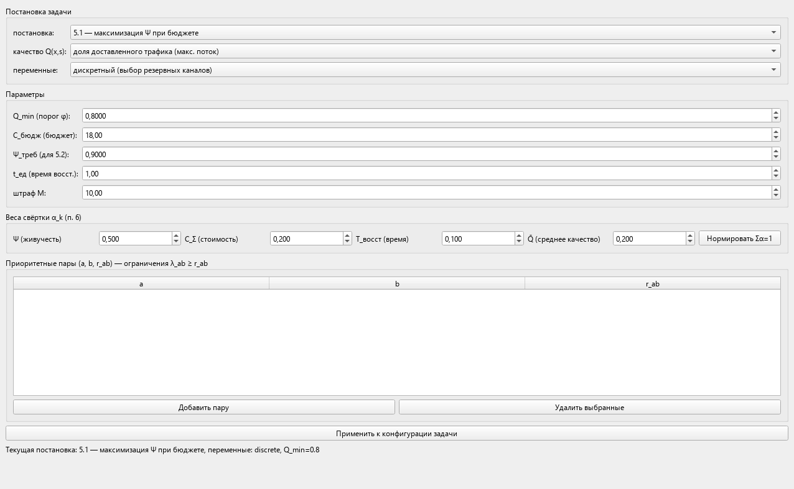

### 2.6. Вкладка «Алгоритм»

Вкладка выбирает алгоритм решения и его параметры. Форма параметров строится
автоматически из реестра алгоритмов: в списке **«Алгоритм решения:»** показаны
только алгоритмы, совместимые с текущей постановкой и режимом переменных
(задаются на вкладке «Задача»), а в группе **«Параметры алгоритма»** появляются
поля выбранного алгоритма с диапазонами по умолчанию.

Реализованы четыре алгоритма:

| Алгоритм | Совместимость | Параметры (подписи в интерфейсе, по умолчанию, диапазон) |
|---|---|---|
| Генетический алгоритм | все постановки и режимы | Размер популяции — 50 (4…500); Число поколений — 100 (1…5000); Вероятность кроссинговера — 0.8 (0…1); Вероятность мутации — 0.05 (0…1); Размер турнира — 3 (2…20); Элитизм (особей) — 1 (0…10) |
| Имитация отжига | все постановки и режимы | Начальная температура T₀ — 1.0 (0.001…1000); Скорость охлаждения — 0.98 (0.5…0.999); Число итераций — 2000 (10…1000000); Минимальная температура — 0.001 (1e-12…1) |
| Ветви и границы | **только постановка 5.1 (max_survivability) и дискретный режим** | Макс. число узлов дерева — 200000 (100…10000000) |
| Жадная эвристика | все постановки и режимы | параметров нет |

Метод ветвей и границ — детерминированный точный алгоритм для малых
экземпляров постановки 5.1; на других постановках или в непрерывном/смешанном
режиме он скрыт из списка, а при попытке запуска с несовместимой конфигурацией
выдаёт ошибку (см. раздел 4). Если совместимых алгоритмов нет, на вкладке
выводится подсказка: «Нет алгоритмов, совместимых с текущей постановкой.
Измените постановку или режим переменных.»

Под формой выводится пояснение: «Алгоритм «…». Параметры подобраны
автоматически из реестра; новые алгоритмы добавляются без изменения кода
интерфейса.»

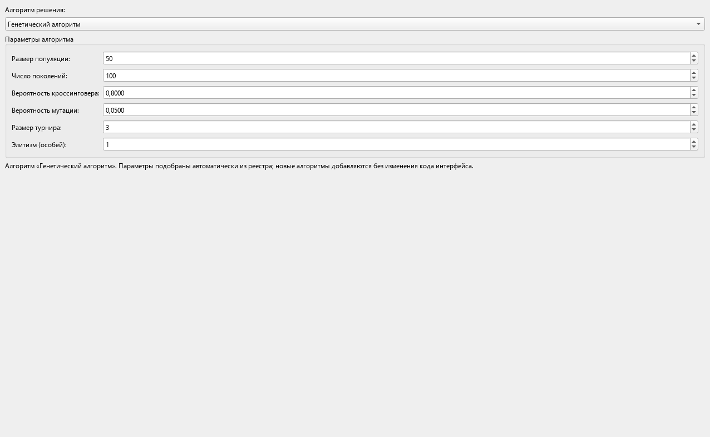

Блок-схемы реализованных алгоритмов (подробное описание — в
[руководстве программиста](developer_guide.md)):

**Генетический алгоритм:**

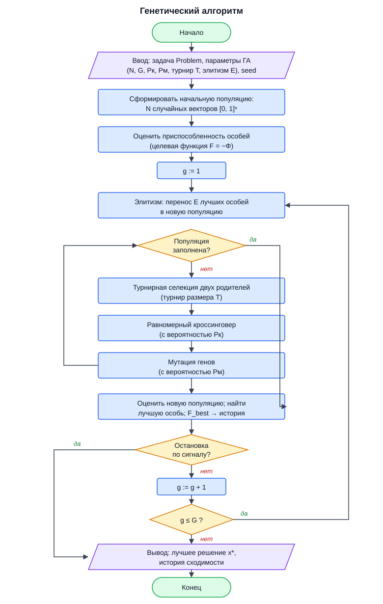

**Имитация отжига:**

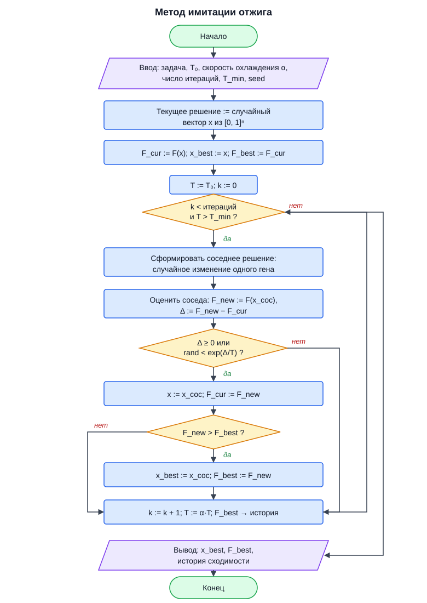

**Метод ветвей и границ (только постановка 5.1, дискретный режим):**

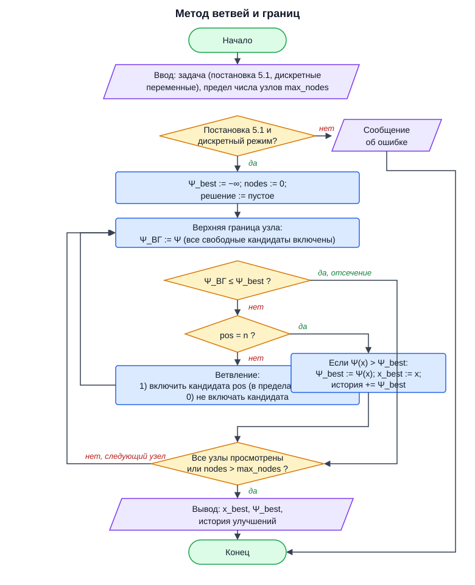

**Жадная эвристика:**

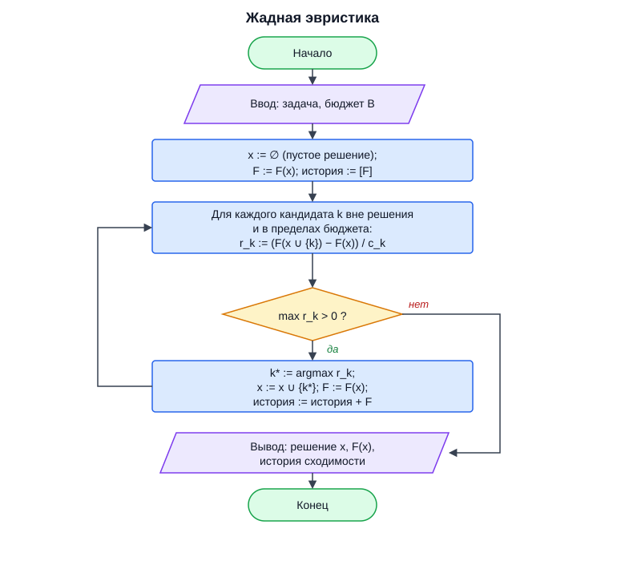

### 2.7. Вкладка «Эксперимент»

Вкладка запускает одно- или многоалгоритмовый эксперимент в фоновом потоке.
Это единственная точка запуска вычислений: одиночный прогон — это эксперимент
с одним отмеченным алгоритмом и «Число прогонов на алгоритм:» = 1.

Элементы управления:

- **«Число прогонов на алгоритм:»** — целое 1…50, по умолчанию 3. Прогоны
  одного алгоритма выполняются с seed = базовый seed + i (i = 0…N−1).
- **«seed (базовый):»** — целое 0…999999, по умолчанию 42. Ставит генераторы
  случайных чисел ГА и отжига; одинаковые seed и параметры дают воспроизводимый
  результат. Детерминированный метод ветвей и границ и жадная эвристика seed
  не используют.
- **Флажки алгоритмов** — по одному на каждый совместимый с постановкой
  алгоритм; отмечены все по умолчанию.
- **«Запустить эксперимент»** — запуск. Перед запуском проверяется наличие
  данных (узлы, потребности, сценарии) и хотя бы одного отмеченного алгоритма.
- **«Остановить»** — мягкая остановка: вычисление прерывается после текущей
  итерации (см. п. 2.9).
- **«Экспорт таблицы (CSV)…»** — сохранение сравнительной таблицы в CSV;
  при пустой таблице выводится «Таблица результатов пуста.».
- **«Экспорт JSON…»** — сохранение результатов всех алгоритмов (лучших прогонов)
  в JSON вместе с конфигурацией задачи; при отсутствии результатов — «Нет
  результатов для экспорта.».
- **Индикатор прогресса** — полоса прогресса и текстовая подпись. Во время
  работы подпись имеет вид «[ga] итерация 57, лучшее F = -5.475000» (ключ
  алгоритма, номер итерации, лучшее значение); после завершения — «Эксперимент
  завершён». Полоса прогресса отражает долю завершённых алгоритмов.

**Сравнительная таблица** — 9 колонок: «алгоритм», «лучшее F», «среднее F»,
«худшее F», «Ψ лучшего», «C_Σ лучшего», «время, с (среднее)»,
«итераций (среднее)», «оценок F (новых)». Значения считаются по всем прогонам
алгоритма; строка появляется сразу после завершения каждого алгоритма.

**График сходимости** (справа от таблицы) — линии лучшего найденного значения F
по итерациям для лучшего прогона каждого алгоритма; оси подписаны «итерация»
и «лучшее значение». Подпись под графиком: «График сходимости (лучший прогон
каждого алгоритма)».

Параметры алгоритмов в эксперименте берутся со вкладки «Алгоритм» для того
алгоритма, который там выбран; для остальных — значения по умолчанию из
реестра. Поэтому для воспроизведения примеров раздела 3 нужный алгоритм
сначала выбирается на вкладке «Алгоритм».

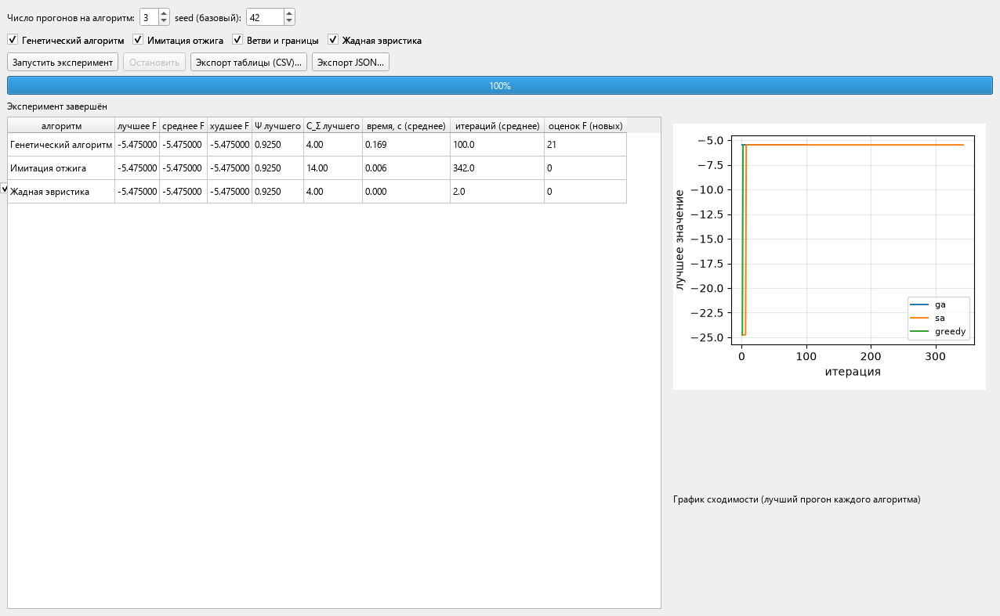

### 2.8. Вкладка «Результаты»

Вкладка показывает подробности найденных решений.

- **«Результат алгоритма:»** — выпадающий список завершённых алгоритмов;
  элемент списка имеет вид «Генетический алгоритм (F=-5.4750)». Пока решений
  нет, выводится «Решений пока нет — запустите эксперимент.».
- **Строка сводки** по выбранному результату:
  «Алгоритм: … | F = … | Ψ = … | C_Σ = … | T_восст = … | Q̄ = … | min Q = … |
  допустимо: да/НЕТ | нарушения: … | итераций: …, оценок: …, время: … с».
  Здесь F — скалярная целевая с учётом штрафов, Ψ — живучесть, C_Σ — стоимость
  резервирования, T_восст — время восстановления, Q̄ — среднее качество по
  сценариям, min Q — наихудшее Q(x, s), «допустимо» — отсутствие нарушений
  ограничений, «нарушения» — список вида «quality=0.8000» или «нет».
- **«Вектор решения x (выбранные резервные каналы):»** — таблица с колонками
  «кандидат», «источник», «назначение», «объём», «стоимость»; перечислены только
  кандидаты с объёмом > 0.
- **«Качество по сценариям:»** — таблица с колонками «сценарий», «p(s)»,
  «Q(x,s)», «φ(Q)» — качество в каждом сценарии и значение пороговой функции
  φ (0 или 1 при сравнении Q с Q_min).
- **«Показать решение на графе»** — перерисовка канваса на вкладке «Топология»
  с выделением резервных каналов (см. п. 2.3); без решения выводится «Сначала
  запустите оптимизацию.».
- **«Экспорт CSV…»** — файл с парами «показатель;значение»: objective, psi,
  cost, t_recovery, q_mean, q_min_actual, feasible, затем объёмы x[…] по
  кандидатам и качество Q[…] по сценариям.
- **«Экспорт JSON…»** — полная структура результата (критерии, допустимость,
  решение, качество по сценариям).

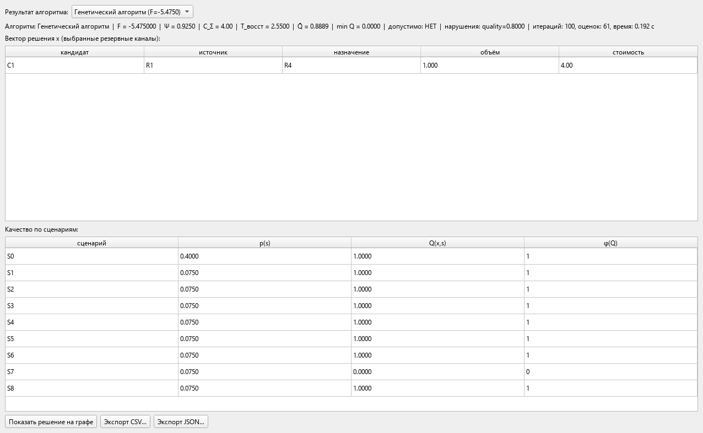

Отрисовка решения на графе (тот же вид, что выводит кнопка «Показать решение
на графе»):


### 2.9. Фоновые вычисления и остановка

Оптимизация выполняется в отдельном потоке (QThread), интерфейс не блокируется:
во время эксперимента можно переключаться между вкладками, смотреть топологию
и результаты уже завершённых алгоритмов. В GUI из потока приходят сигналы
прогресса (итерация, лучшее значение) и результатов. Кнопка **«Остановить»**
устанавливает флаг, который проверяется алгоритмом на каждой итерации, — после
текущей итерации вычисление завершается, а подпись прогресса меняется на
«Остановка после текущей итерации…». Ошибки алгоритмов не «роняют» приложение:
они показываются диалогом «Ошибка эксперимента» с текстом исключения и пишутся
в журнал `optimnet.log`.

### 2.10. Диалог «О программе»

Открывается из меню «Справка → О программе». Текст диалога:

> OptimNet — ПО оптимизации живучести компьютерной сети.
>
> Сеть моделируется взвешенным ориентированным графом G = ⟨V, E, C, W⟩;
> живучесть Ψ(x) = Σ p(s)·φ(Q(x,s)) (doc/optim.md). Постановки 5.1–5.3 и
> аддитивная свёртка критериев; алгоритмы: генетический, имитация отжига,
> ветви и границы, жадная эвристика.
>
> Версия 1.0, Python + PyQt6.

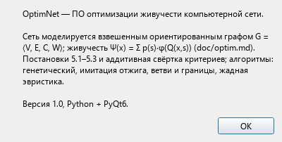

## 3. Примеры использования

Все числовые результаты в примерах ниже — реальные прогоны приложения,
сохранённые в [`results_doc_examples.json`](results_doc_examples.json)
(их выполняет скрипт `scripts/run_doc_examples.py`). Время выполнения зависит
от аппаратуры и при повторении может отличаться; значения критериев при тех же
параметрах и seed воспроизводятся точно. Время в примерах указано по JSON,
длинные дробные значения округлены до 3–4 знаков со знаком «≈».

Общий порядок запуска любого примера:

1. Загрузить топологию (меню «Файл → Демо-примеры…» или «Файл → Открыть
   пример (JSON)…») либо ввести её вручную на вкладке «Топология» и нажать
   «Применить таблицы → модель».
2. Настроить постановку на вкладке «Задача» и нажать «Применить к
   конфигурации задачи».
3. Выбрать алгоритм и его параметры на вкладке «Алгоритм».
4. На вкладке «Эксперимент» установить «Число прогонов на алгоритм:» и
   «seed (базовый):», отметить нужный алгоритм и нажать «Запустить
   эксперимент».
5. Открыть вкладку «Результаты» и разобрать решение.

Номера примеров совпадают с id в `results_doc_examples.json`.

### Пример 1. Постановка 5.1: генетический алгоритм на средней сети

- **Цель.** Максимизировать живучесть Ψ при бюджете 18 на средней демо-сети;
   показать типичный вид результата ГА (включая случай недопустимого решения
   и штраф в целевой функции).
- **Исходные данные.** Меню «Файл → Демо-примеры → Средний (10 узлов)»
   (тот же файл `examples/medium.json`; он же загружается при старте).
   Топология: узлы R1–R8 (маршрутизаторы) и S1, S2 (серверы); 24
   ориентированных канала ёмкостью 10; потребность S1 → S2 объёмом 8;
   6 кандидатов: C1 (R1 → R4, ёмкость 10, стоимость 4), C2 (R2 → R6, 10, 6),
   C3 (R3 → R7, 10, 8) и обратные C1r, C2r, C3r (R4 → R1, R6 → R2, R7 → R3
   при тех же ёмкостях и стоимостях). Сценарии: S0 (p = 0.4, штатный режим
   без отказов) и S1–S8 (по p = 0.075 каждый, с отказами каналов).
- **Настройки задачи.** Вкладка «Задача»: постановка «5.1 — максимизация Ψ
   при бюджете»; качество «доля доставленного трафика (макс. поток)»;
   переменные «дискретный (выбор резервных каналов)»; Q_min = 0.8;
   C_бюдж = 18.0 (подставляется автоматически как 0.5 · (4+6+8+4+6+8) = 18);
   Ψ_треб = 0.9; t_ед = 1.0; штраф M = 10; веса 0.5 / 0.2 / 0.1 / 0.2.
- **Настройки алгоритма.** Вкладка «Алгоритм»: «Генетический алгоритм»,
   параметры по умолчанию: размер популяции 50, число поколений 100,
   вероятность кроссинговера 0.8, вероятность мутации 0.05, размер турнира 3,
   элитизм 1.
- **Запуск.** Вкладка «Эксперимент»: «Число прогонов на алгоритм:» = 1,
   «seed (базовый):» = 42, отметить только флажок «Генетический алгоритм»,
   нажать «Запустить эксперимент». Дождаться «Эксперимент завершён».
- **Ожидаемый результат** (id 1 в JSON):

   | Показатель | Значение |
   |---|---|
   | Целевая F | −5.475 |
   | Живучесть Ψ | 0.925 |
   | Стоимость C_Σ | 4.0 |
   | Время восстановления T_восст | 2.55 |
   | Среднее качество Q̄ | ≈ 0.889 (0.888889) |
   | min Q(x, s) | 0.0 |
   | Допустимо | НЕТ |
   | Нарушения | quality = 0.8 |
   | Итераций / оценок F / время | 100 / 61 / ≈ 0.211 с (0.2105) |

   Решение x: выбран один кандидат — **C1 (R1 → R4), объём 1.0**, добавленная
   ёмкость 10.0, стоимость 4.0.
- **Как прочитать результаты.** Строка сводки на вкладке «Результаты»
   показывает: F = −5.475 = Ψ − M·(нарушение)² = 0.925 − 10·0.8². Живучесть
   Ψ = 0.925 = 1 − 0.075: таблица «Качество по сценариям» содержит один
   сценарий с φ(Q) = 0 (Q < Q_min = 0.8), все остальные проходят порог.
   Решение помечено «допустимо: НЕТ» из-за суммарного дефицита качества
   0.8, поэтому в F действует штраф. Бюджет 18 не исчерпан (потрачено 4 из
   18) — алгоритму не выгодно брать дополнительные кандидаты: они не поднимают
   Ψ достаточно, чтобы окупить штраф/стоимость. Таблица «Вектор решения x»
   подтверждает выбор только C1; на канвасе (кнопка «Показать решение на
   графе») зелёной стрелкой виден резерв R1 → R4 с подписью объёма «1.00».
   График сходимости на вкладке «Эксперимент» для этого прогона — горизонтальная
   линия на уровне −5.475: лучшее значение найдено уже в начале поиска
   (история лучшего из 100 поколений не меняется).

### Пример 2. Постановка 5.1: имитация отжига, другое решение той же задачи

- **Цель.** Показать, что одна и та же постановка 5.1 на средней сети имеет
   разные допустимые по бюджету решения: отжиг выбирает три резерва вместо
   одного при том же Ψ.
- **Исходные данные.** Те же, что в примере 1 (`examples/medium.json`).
- **Настройки задачи.** Те же, что в примере 1 (5.1, flow, дискретные
   переменные, Q_min = 0.8, C_бюдж = 18.0, веса 0.5/0.2/0.1/0.2).
- **Настройки алгоритма.** Вкладка «Алгоритм»: «Имитация отжига»:
   T₀ = 1.0, скорость охлаждения 0.98, число итераций 2000,
   минимальная температура T_min = 0.001.
- **Запуск.** Вкладка «Эксперимент»: 1 прогон, seed = 42, отметить только
   «Имитация отжига», «Запустить эксперимент».
- **Ожидаемый результат** (id 2 в JSON):

   | Показатель | Значение |
   |---|---|
   | Целевая F | −5.475 |
   | Живучесть Ψ | 0.925 |
   | Стоимость C_Σ | 14.0 |
   | Время восстановления T_восст | 2.55 |
   | Среднее качество Q̄ | ≈ 0.889 (0.888889) |
   | min Q(x, s) | 0.0 |
   | Допустимо | НЕТ |
   | Нарушения | quality = 0.8 |
   | Итераций / оценок F / время | 342 / 47 / ≈ 0.035 с (0.0348) |

   Решение x: **C1 (R1 → R4), C1r (R4 → R1) и C2r (R6 → R2)**, все объёмом
   1.0, добавленная ёмкость 10.0 каждый, стоимости 4.0 + 4.0 + 6.0 = 14.0.
- **Как прочитать результаты.** Ψ, Q̄ и нарушения совпадают с примером 1 —
   те же сценарии не проходят порог Q_min, штраф тот же (F = 0.925 − 6.4).
   Различие в стоимости: отжиг закупил резервы в обе стороны по транзитной
   паре R1 ↔ R4 и по паре R6 → R2, потратив 14 из 18 бюджета. Обратите
   внимание на «итераций: 342» при лимите 2000: отжиг останавливается
   досрочно, когда температура падает ниже T_min. График сходимости лучшего
   прогона показывает плато −24.75 в первых итерациях и переход к −5.475 —
   момент, когда найдено решение с меньшим штрафом. На канвасе видны три
   зелёные стрелки (R1 → R4, R4 → R1, R6 → R2).

### Пример 3. Постановка 5.1: точное решение методом ветвей и границ

- **Цель.** Найти гарантированный оптимум на малой сети методом ветвей и
   границ и сравнить его качество с эвристиками.
- **Исходные данные.** Меню «Файл → Демо-примеры → Малый (6 узлов)»
   (`examples/small.json`). Узлы R1–R4 (маршрутизаторы), S1, S2 (серверы);
   16 каналов ёмкостью 10 (подсети маршрутизаторов стоят 2, подключения
   серверов — 1); потребность S1 → S2 объёмом 8; кандидаты C1 (R1 → R3, 10,
   стоимость 4), C2 (R2 → R4, 10, 6) и обратные C1r (R3 → R1, 4), C2r
   (R4 → R2, 6); 7 сценариев S0 (p = 0.4) и S1–S6 (по p = 0.1) с отказами
   каналов.
- **Настройки задачи.** Постановка «5.1 — максимизация Ψ при бюджете»;
   качество «доля доставленного трафика (макс. поток)»; переменные
   «дискретный»; Q_min = 0.8; C_бюдж = 10.0 (авто: 0.5 · (4+6+4+6) = 10);
   Ψ_треб = 0.9; t_ед = 1.0; штраф M = 10; веса 0.5/0.2/0.1/0.2.
- **Настройки алгоритма.** Вкладка «Алгоритм»: «Ветви и границы»; параметр
   «Макс. число узлов дерева» = 200000. Алгоритм детерминирован, seed не
   задаётся.
- **Запуск.** Вкладка «Эксперимент»: 1 прогон, флажок «Ветви и границы»
   (значение seed роли не играет), «Запустить эксперимент».
- **Ожидаемый результат** (id 3 в JSON):

   | Показатель | Значение |
   |---|---|
   | Целевая F | 1.0 |
   | Живучесть Ψ | 1.0 |
   | Стоимость C_Σ | 10.0 |
   | Время восстановления T_восст | 2.0 |
   | Среднее качество Q̄ | 1.0 |
   | min Q(x, s) | 1.0 |
   | Допустимо | да |
   | Нарушения | нет |
   | Итераций / оценок F / время | 7 / 5 / ≈ 0.002 с (0.0021) |

   Решение x: **C1 (R1 → R3) и C2 (R2 → R4)**, объёмы 1.0, добавленная
   ёмкость 10.0 каждый, стоимости 4.0 + 6.0 = 10.0 — ровно бюджет.
- **Как прочитать результаты.** Это точный оптимум: метод ветвей и границ
   перебирает дерево подмножеств кандидатов с отсечением по верхней границе
   (Ψ монотонно не убывает при добавлении резервов). Все сценарии проходят
   порог Q_min (min Q = 1.0, φ = 1 везде), поэтому Ψ = 1.0 и решение
   допустимо; штраф отсутствует, F = Ψ = 1.0. В таблице «Качество по
   сценариям» все φ(Q) = 1. Для полноты бюджета — строгое равенство
   C_Σ = 10.0 = C_бюдж. Метод требует всего 7 узлов дерева и 5 оценок F —
   малая сеть решена мгновенно. На канвасе — две зелёные стрелки
   R1 → R3 и R2 → R4.

### Пример 4. Постановка 5.1: жадная эвристика

- **Цель.** Получить быструю оценку решения постановки 5.1 на средней сети
   без настройки параметров (у эвристики их нет).
- **Исходные данные.** `examples/medium.json` (см. пример 1).
- **Настройки задачи.** Как в примере 1 (5.1, flow, дискретные, Q_min = 0.8,
   C_бюдж = 18.0).
- **Настройки алгоритма.** Вкладка «Алгоритм»: «Жадная эвристика»; параметров
   нет (форма пустая).
- **Запуск.** Вкладка «Эксперимент»: 1 прогон (seed не используется),
   отметить только «Жадная эвристика», «Запустить эксперимент».
- **Ожидаемый результат** (id 4 в JSON):

   | Показатель | Значение |
   |---|---|
   | Целевая F | −5.475 |
   | Живучесть Ψ | 0.925 |
   | Стоимость C_Σ | 4.0 |
   | Время восстановления T_восст | 2.55 |
   | Среднее качество Q̄ | ≈ 0.889 (0.888889) |
   | min Q(x, s) | 0.0 |
   | Допустимо | НЕТ |
   | Нарушения | quality = 0.8 |
   | Итераций / оценок F / время | 2 / 12 / ≈ 0.007 с (0.0072) |

   Решение x: **C1 (R1 → R4)**, объём 1.0, стоимость 4.0.
- **Как прочитать результаты.** Жадная эвристика за 2 итерации нашла то же
   решение, что и ГА в примере 1 (C1 за 4.0), — на этой сети локально
   выгодный резерв очевиден. Те же Ψ = 0.925 и штраф quality = 0.8. График
   сходимости состоит из двух точек: −24.75 (пустое решение) → −5.475.
   Жадный выбор — хорошая стартовая точка и эталон скорости, но он не
   гарантирует оптимума (сравните с Ψ = 1.0 на малой сети в примере 3).

### Пример 5. Постановка 5.2: минимизация стоимости при Ψ ≥ Ψ_треб

- **Цель.** Спроектировать самое дешёвое резервирование, при котором живучесть
   не ниже Ψ_треб = 0.9 (постановка 5.2 из optim.md).
- **Исходные данные.** `examples/medium.json` (см. пример 1).
- **Настройки задачи.** Вкладка «Задача»: постановка «5.2 — минимизация
   стоимости при Ψ ≥ Ψ_треб»; качество «доля доставленного трафика
   (макс. поток)»; переменные «дискретный»; Q_min = 0.8; C_бюдж = 18.0;
   **Ψ_треб = 0.9**; t_ед = 1.0; штраф M = 10; веса 0.5/0.2/0.1/0.2
   (в постановке 5.2 не используются — целевая функция равна −C_Σ со
   штрафами, но поля остаются на месте).
- **Настройки алгоритма.** Вкладка «Алгоритм»: «Генетический алгоритм»,
   параметры по умолчанию (50 / 100 / 0.8 / 0.05 / 3 / 1).
- **Запуск.** Вкладка «Эксперимент»: 1 прогон, seed = 42, только
   «Генетический алгоритм», «Запустить эксперимент».
- **Ожидаемый результат** (id 5 в JSON):

   | Показатель | Значение |
   |---|---|
   | Целевая F | −10.4 |
   | Живучесть Ψ | 0.925 |
   | Стоимость C_Σ | 4.0 |
   | Время восстановления T_восст | 2.55 |
   | Среднее качество Q̄ | ≈ 0.889 (0.888889) |
   | min Q(x, s) | 0.0 |
   | Допустимо | НЕТ |
   | Нарушения | quality = 0.8 |
   | Итераций / оценок F / время | 100 / 47 / ≈ 0.178 с (0.1782) |

   Решение x: **C1 (R1 → R4)**, объём 1.0, стоимость 4.0.
- **Как прочитать результаты.** В постановке 5.2 выгодное направление —
   минимизация: F = −C_Σ − M·Σ(нарушений²) = −4.0 − 10·0.8² = −10.4.
   Требование Ψ ≥ 0.9 выполнено (Ψ = 0.925), однако решение всё равно
   недопустимо: в постановке 5.2 сохраняется условие Q(x, s) ≥ Q_min для
   всех сценариев, а min Q = 0 < 0.8. Если такой дефицит неприемлем, нужно
   увеличить бюджет/список кандидатов или ослабить Q_min (см. раздел 4).
   Обратите внимание: бюджет 18 в этой постановке уже не ограничивает поиск
   сверху (C_Σ = 4), его роль — масштабирующий параметр свёртки и общий
   предохранитель.

### Пример 6. Постановка 5.3: робастная (минимакс по сценариям)

- **Цель.** Найти решение, максимизирующее наихудшее качество min Q(x, s)
   по сценариям (робастная постановка 5.3), и сравнить его с решением 5.1.
- **Исходные данные.** `examples/medium.json` (см. пример 1).
- **Настройки задачи.** Вкладка «Задача»: постановка «5.3 — робастная
   (минимакс по сценариям)»; качество «доля доставленного трафика
   (макс. поток)»; переменные «дискретный»; Q_min = 0.8; C_бюдж = 18.0;
   Ψ_треб = 0.9; t_ед = 1.0; штраф M = 10; веса 0.5/0.2/0.1/0.2.
- **Настройки алгоритма.** Вкладка «Алгоритм»: «Имитация отжига»:
   T₀ = 1.0, охлаждение 0.98, итераций 2000, T_min = 0.001.
- **Запуск.** Вкладка «Эксперимент»: 1 прогон, seed = 42, только
   «Имитация отжига», «Запустить эксперимент».
- **Ожидаемый результат** (id 6 в JSON):

   | Показатель | Значение |
   |---|---|
   | Целевая F | −6.4 |
   | Живучесть Ψ | 0.925 |
   | Стоимость C_Σ | 14.0 |
   | Время восстановления T_восст | 2.55 |
   | Среднее качество Q̄ | ≈ 0.889 (0.888889) |
   | min Q(x, s) | 0.0 |
   | Допустимо | НЕТ |
   | Нарушения | quality = 0.8 |
   | Итераций / оценок F / время | 342 / 47 / ≈ 0.037 с (0.0367) |

   Решение x: **C1 (R1 → R4), C1r (R4 → R1), C2r (R6 → R2)**, стоимости
   4.0 + 4.0 + 6.0 = 14.0.
- **Как прочитать результаты.** Целевая функция минимакса — наихудшее
   качество: F = min Q − M·Σ(нарушений²) = 0.0 − 10·0.8² = −6.4. Здесь
   min Q = 0 — есть сценарий, в котором потребность S1 → S2 полностью
   не обслуживается (Q = 0), и три купленных резерва не спасают именно его.
   Отжиг остановился на том же наборе, что в примере 2: с точки зрения
   min Q дополнительные резервы не улучшают наихудший сценарий, поэтому
   робастная постановка «не видит» разницы между наборами за 4.0 и за 14.0,
   а выбор делается на итерациях случайного поиска. Практический вывод: если
   наихудший сценарий неприемлем, набор кандидатов нужно расширить (в сети
   нет резерва, перекрывающего отказ именно этого сценария).

### Пример 7. Многокритериальная свёртка на большой сети, смешанные переменные

- **Цель.** Решить задачу аддитивной свёртки четырёх критериев
   (живучесть, стоимость, время восстановления, среднее качество) на большой
   сети 20 узлов в смешанном режиме переменных.
- **Исходные данные.** Меню «Файл → Демо-примеры → Большой (20 узлов)»
   (`examples/large.json`). Узлы R1–R16 (маршрутизаторы) и S1–S4 (серверы);
   48 каналов; шесть потребностей между серверами S1–S4 объёмом 8 каждая;
   12 кандидатов: C1 (R1 → R8, 10, 4), C2 (R2 → R9, 10, 6),
   C3 (R3 → R10, 10, 8), C4 (R4 → R12, 10, 10), C5 (R5 → R13, 10, 12),
   C6 (R6 → R14, 10, 14) и обратные C1r…C6r при тех же характеристиках.
   Сценарии: S0 (p = 0.4) и S1–S10 (по p = 0.06).
- **Настройки задачи.** Вкладка «Задача»: постановка «6 — аддитивная свёртка
   критериев»; качество «доля доставленного трафика (макс. поток)»;
   переменные **«смешанный (каналы + объёмы)»**; Q_min = 0.8;
   C_бюдж = 54.0 (авто: 0.5 · 108); Ψ_треб = 0.9; t_ед = 1.0; штраф M = 10;
   веса **Ψ = 0.5, C_Σ = 0.2, T_восст = 0.1, Q̄ = 0.2** (по умолчанию,
   Σα = 1).
- **Настройки алгоритма.** Вкладка «Алгоритм»: «Генетический алгоритм»,
   параметры по умолчанию (50 / 100 / 0.8 / 0.05 / 3 / 1).
- **Запуск.** Вкладка «Эксперимент»: 1 прогон, seed = 42, только
   «Генетический алгоритм», «Запустить эксперимент». На большой сети прогон
   занимает заметно больше времени (единицы секунд — порядка 10 с).
- **Ожидаемый результат** (id 7 в JSON):

   | Показатель | Значение |
   |---|---|
   | Целевая F | ≈ −127.941 (−127.940818) |
   | Живучесть Ψ | 0.4 |
   | Стоимость C_Σ | ≈ 9.453 (9.452726) |
   | Время восстановления T_восст | 4.86 |
   | Среднее качество Q̄ | ≈ 0.485 (0.484848) |
   | min Q(x, s) | 0.0 |
   | Допустимо | НЕТ |
   | Нарушения | quality ≈ 3.583 (3.583333) |
   | Итераций / оценок F / время | 100 / 1738 / ≈ 8.441 с |

   Решение x (смешанный режим — у кандидатов дробные объёмы):

   | Кандидат | Пара | Объём | Добавленная ёмкость | Стоимость |
   |---|---|---|---|---|
   | C1 | R1 → R8 | 0.8009 | ≈ 8.009 (8.0091) | ≈ 3.204 (3.2036) |
   | C2 | R2 → R9 | 1.0 | 10.0 | 6.0 |
   | C1r | R8 → R1 | 0.0623 | ≈ 0.623 (0.6227) | ≈ 0.249 (0.2491) |
- **Как прочитать результаты.** Смешанный режим отличается тем, что алгоритм
   подбирает и набор кандидатов, и доли резервирования: видно, что C2 взят
   полностью (объём 1.0), C1 — на ≈ 80 %, а обратный C1r — лишь на ≈ 6 %.
   Свёртка нормирует критерии в [0, 1] и взвешивает их α_k; штраф здесь
   доминирует: дефицит качества ≈ 3.583 по всем сценариям даёт
   M·Σ(наруш²) ≈ 10·12.84 ≈ 128.4, поэтому F сильно отрицательна, а Ψ = 0.4
   означает, что порог Q_min проходят только сценарии суммарной вероятностью
   0.4 (штатный S0). Для большой сети бюджета 54 не хватает, чтобы обеспечить
   Q ≥ 0.8 в поражённых сценариях, — это видно и по T_восст = 4.86: почти ни
   один отказ каналов не перекрыт резервом на той же паре узлов. Таблица
   «Качество по сценариям» показывает вклад каждого сценария: φ = 1 только
   в S0. Вывод для проектировщика: при данных кандидатах и бюджете требование
   Q_min = 0.8 во всех сценариях недостижимо — нужно больше бюджета, другие
   кандидаты или менее жёсткий порог.

### Пример 8. Сравнительный эксперимент: три алгоритма × три прогона

- **Цель.** Сравнить генетический алгоритм, имитацию отжига и жадную
   эвристику на одном наборе данных по устойчивости результата к выбору seed.
- **Исходные данные.** `examples/medium.json` (см. пример 1).
- **Настройки задачи.** Как в примере 1 (5.1, flow, дискретные, Q_min = 0.8,
   C_бюдж = 18.0).
- **Настройки алгоритма.** Вкладка «Алгоритм»: выбрать по очереди каждый
   алгоритм и убедиться в параметрах: ГА — 50/100/0.8/0.05/3/1; отжиг —
   1.0/0.98/2000/0.001; жадная эвристика — без параметров. Поскольку
   параметры в эксперименте берутся со вкладки «Алгоритм» только для выбранного
   там алгоритма, для воспроизведения достаточно оставить значения по
   умолчанию (они совпадают с указанными).
- **Запуск.** Вкладка «Эксперимент»: «Число прогонов на алгоритм:» = 3,
   «seed (базовый):» = 42, отметить все три флажка («Генетический алгоритм»,
   «Имитация отжига», «Жадная эвристика»), «Запустить эксперимент». Прогоны
   выполнятся с seed 42, 43 и 44 для каждого алгоритма.
- **Ожидание.** Таблица сравнения заполнится по мере завершения алгоритмов
   (строки появляются сразу после каждого алгоритма), график сходимости
   накопит три линии. Ожидаемый результат (id 8 в JSON) — сводная таблица:

   | Алгоритм | Лучшее F | Среднее F | Худшее F | Ψ лучшего | C_Σ лучшего | Время, с (среднее) | Итераций (среднее) | Оценок F (новых) |
   |---|---|---|---|---|---|---|---|---|
   | Генетический алгоритм | −5.475 | −5.475 | −5.475 | 0.925 | 4.0 | ≈ 0.165 (0.1653) | 100.0 | 21.3 |
   | Имитация отжига | −5.475 | −5.475 | −5.475 | 0.925 | 14.0 | ≈ 0.006 (0.0062) | 342.0 | 0.0 |
   | Жадная эвристика | −5.475 | −5.475 | −5.475 | 0.925 | 4.0 | ≈ 0.0002 | 2.0 | 0.0 |

   Целевые значения всех девяти прогонов (objectives по seed 42/43/44):
   −5.475 у каждого алгоритма, т.е. разброс по seed отсутствует.
   Лучшие прогоны: ГА — C1 (стоимость 4.0); отжиг — C1 + C1r + C2r
   (стоимость 14.0); жадная — C1 (4.0).
- **Как прочитать результаты.** Все алгоритмы сошлись к одной целевой F,
   но по-разному: ГА стабилен при среднем времени ≈ 0.165 с за прогон;
   отжиг в ~27 раз быстрее (≈ 0.006 с), но «переплатил» за резервирование
   (14.0 против 4.0) — равенство F объясняется штрафом: при Ψ = 0.925 и
   нарушении quality = 0.8 F = 0.925 − 10·0.8² = −5.475 независимо от
   стоимости. Столбец «Оценок F (новых)» у отжига и жадной эвристики равен
   0.0 не потому, что оценок не было, а потому, что оценки решений кэшируются
   по ключу вектора x внутри одной задачи: ГА первым исчерпал большинство
   новых точек, а последующие прогоны получали их из кэша. На графике
   сходимости видны три характерных профиля: ГА — сразу −5.475; отжиг —
   плато −24.75 (пустое решение с полным штрафом) первые ~5 отметок и затем
   переход к −5.475; жадная — две точки: −24.75 → −5.475. Кнопка
   «Экспорт таблицы (CSV)…» сохранит эту таблицу, «Экспорт JSON…» — лучшие
   прогоны с конфигурацией.

### Пример 9. Ручной ввод топологии: мини-сеть из трёх узлов

- **Цель.** Построить топологию с нуля таблицами вкладки «Топология»,
   задать сценарии вручную и решить постановку 5.1 (та же топология
   используется в тестах проекта, `tests/conftest.py`).
- **Исходные данные** (вводятся вручную). Вкладка «Топология»:
   - таблица «Узлы»: `A | сервер`, `B | маршрутизатор`, `C | сервер`;
   - таблица «Каналы»: `A | B | 5 | 2 | 0 | 0.99`; `B | C | 5 | 2 | 0 | 0.99`;
     `A | C | 2 | 1 | 0 | 0.99` (ёмкость, стоимость, задержка, надёжность);
   - таблица «Потребности»: `A | C | 8`;
   - таблица «Кандидаты»: `C1 | A | B | 10 | 3`; `C2 | B | C | 10 | 4`.
   Нажать **«Применить таблицы → модель»**. На канвасе появится граф из трёх
   узлов: поток A → B → C ограничен каналом B → C (ёмкость 5), прямой канал
   A → C даёт 2, суммарно без резерва доставляется 7 из 8, т.е. Q = 0.875.
   Вкладка «Сценарии»: нажать «Новый сценарий» дважды и заполнить редактор:
   сценарий **S0** — вероятность p(s) = 0.6, отказавшие узлы и каналы пустые;
   сценарий **S1** — p(s) = 0.4, отказавшие узлы: `B` (поле «отказавшие
   каналы:» оставить пустым); после каждого — «Применить изменения».
- **Настройки задачи.** Вкладка «Задача»: постановка «5.1 — максимизация Ψ
   при бюджете»; качество «доля доставленного трафика (макс. поток)»;
   переменные «дискретный»; Q_min = 0.8; C_бюдж = 3.5 (= 0.5 · (3 + 4) —
   именно такое значение приложение подставляет автоматически);
   Ψ_треб = 0.9; t_ед = 1.0; штраф M = 10; веса 0.5/0.2/0.1/0.2.
- **Настройки алгоритма.** Вкладка «Алгоритм»: «Генетический алгоритм»,
   параметры по умолчанию.
- **Запуск.** Вкладка «Эксперимент»: 1 прогон, seed = 42, только
   «Генетический алгоритм», «Запустить эксперимент».
- **Ожидаемый результат** (id 9 в JSON):

   | Показатель | Значение |
   |---|---|
   | Целевая F | −2.425 |
   | Живучесть Ψ | 0.6 |
   | Стоимость C_Σ | 0.0 |
   | Время восстановления T_восст | 0.0 |
   | Среднее качество Q̄ | 0.5625 |
   | min Q(x, s) | 0.25 |
   | Допустимо | НЕТ |
   | Нарушения | quality = 0.55 |
   | Итераций / оценок F / время | 100 / 4 / ≈ 0.188 с (0.1875) |

   Решение x: **пустое — ни один кандидат не выбран**.
- **Как прочитать результаты.** Это показательный «неуспешный» прогон, и он
   закономерен. В штатном сценарии S0 без резерва Q = 7/8 = 0.875
   (поток A → B → C равен 5 и A → C равен 2); в сценарии S1 (отказ узла B)
   остаётся только прямой канал A → C ёмкостью 2, Q = 2/8 = 0.25. Ψ =
   0.6·φ(0.875) + 0.4·φ(0.25) = 0.6·1 + 0.4·0 = 0.6. Дефицит качества:
   (0.8 − 0.25) = 0.55 в S1, F = 0.6 − 10·0.55² = −2.425. Почему ГА не купил
   резерв? Кандидат C1 (A → B, стоимость 3 ≤ 3.5) не помогает в S1: узел B
   отказал, и резерв A → B бесполезен. Кандидат C2 (B → C, стоимость 4)
   уже не влезает в бюджет 3.5, а вместе они стоят 7 > 3.5. Значит,
   единственный способ поднять Q в S1 — расширить бюджет до ≥ 4 (тогда C2
   даст в S0 Q = 1.0, но S1 всё равно останется при Q = 0.25!) — на этой
   топологии сценарий S1 вообще нельзя улучшить имеющимися кандидатами:
   оба кандидата проходят через отказавший узел B. Выводы для практики:
   1) бюджет 3.5 недостаточен, а кандидаты, не обходящие узел B (например,
   резерв на пару A → C), отсутствуют; 2) таблица «Качество по сценариям»
   сразу показывает виновника: S1 с Q = 0.25; 3) «Вектор решения x» пуст —
   в колонке «кандидат» нет строк.

### Пример 10. Вариант качества «связность» и генератор случайных сценариев

- **Цель.** Показать второй вариант функции качества Q(x, s) — связность
   критических пар — и работу генератора случайных сценариев; сравнить штатные
   и сгенерированные сценарии на одной сети.
- **Исходные данные.** `examples/medium.json` (см. пример 1). Критические
   пары для режима связности формируются из потребностей: пара S1 → S2.
- **Настройки задачи.** Вкладка «Задача»: постановка «5.1 — максимизация Ψ
   при бюджете»; качество **«связность критических пар»** (connectivity);
   переменные «дискретный»; Q_min = 0.8; C_бюдж = 18.0; Ψ_треб = 0.9;
   t_ед = 1.0; штраф M = 10; веса 0.5/0.2/0.1/0.2. Для подпрогона Б на
   вкладке «Сценарии» нажать «Сгенерировать» с параметрами по умолчанию
   (число сценариев 8, P(отказа канала) 0.15, P(отказа узла) 0.05, seed 42,
   флажок «оставить текущие сценарии (добавить)» снят) — список заменится на
   S0 (p = 0.4) плюс 8 случайных сценариев S1–S8 с p = 0.075 каждый.
- **Настройки алгоритма.** Вкладка «Алгоритм»: «Генетический алгоритм»,
   параметры по умолчанию.
- **Запуск.** Два последовательных прогона (id 10 в JSON содержит оба):
   1. Штатные 9 сценариев medium.json: вкладка «Эксперимент», 1 прогон,
      seed = 42, только ГА, «Запустить эксперимент».
   2. Сгенерированные сценарии: после генерации (см. выше) — повторить запуск
      с теми же настройками.
- **Ожидаемый результат.** Подпрогон 1 (штатные сценарии, Q — связность):

   | Показатель | Значение |
   |---|---|
   | Целевая F | −5.475 |
   | Живучесть Ψ | 0.925 |
   | Стоимость C_Σ | 4.0 |
   | Время восстановления T_восст | 2.55 |
   | Среднее качество Q̄ | ≈ 0.889 (0.888889) |
   | min Q(x, s) | 0.0 |
   | Допустимо | НЕТ (нарушения: quality = 0.8) |
   | Итераций / оценок F / время | 100 / 61 / ≈ 0.189 с (0.1887) |

   Подпрогон 2 (сгенерированные сценарии, Q — связность):

   | Показатель | Значение |
   |---|---|
   | Целевая F | −5.475 |
   | Живучесть Ψ | 0.925 |
   | Стоимость C_Σ | 4.0 |
   | Время восстановления T_восст | 2.325 |
   | Среднее качество Q̄ | ≈ 0.889 (0.888889) |
   | min Q(x, s) | 0.0 |
   | Допустимо | НЕТ (нарушения: quality = 0.8) |
   | Итераций / оценок F / время | 100 / 61 / ≈ 0.196 с (0.1963) |

   Решение в обоих подпрогонах: **C1 (R1 → R4)**, объём 1.0, стоимость 4.0.
   Сгенерированные сценарии (seed 42): S1 — узлы R2, S2; каналы R1-R2,
   R2-R3, R6-R5, S1-R1. S2 — узел R8; каналы R1-R2, R2-R3, R5-S2. S3 —
   каналы R6-R7, R7-R6, R7-R8, S1-R1, S2-R5. S4 — каналы R2-S1, R7-R8,
   R8-R1, S2-R5. S5 — каналы R2-S1, R5-R6, R5-S2, R8-R1. S6 — каналы
   R1-S1, R3-R2. S7 — каналы R4-S2, R6-R7, S1-R1. S8 — каналы R3-R4,
   R4-S2, R5-R6 (все по p = 0.075).
- **Как прочитать результаты.** Режим «связность критических пар» считает Q
   иначе: это доля приоритетных пар (здесь одна пара S1 → S2 из потребностей),
   сохраняющих связность хотя бы одним путём в сценарии s. Значения F и Ψ
   совпали с потоковым режимом случайно ли закономерно — судить по конкретной
   сети; показательно другое: в подпрогоне 2 изменился только T_восст
   (2.55 → 2.325) — сгенерированные сценарии содержат меньше отказов каналов,
   не перекрытых резервом, чем штатные. Время восстановления по модели
   T_восст = t_ед · Σ p(s)·n(s)·(1 − κ(s)) чувствительно к набору сценариев,
   и именно оно раскрывает различие между двумя вариантами. Это демонстрирует
   типовую методику: зафиксировать сеть и постановку, сравнить «экспертные»
   (штатные) сценарии со случайной генерацией и проверить устойчивость выбора
   решения (x = C1 в обоих случаях).

## 4. Возможные проблемы и решения

### 4.1. Данные не заданы или некорректны

| Симптом | Причина | Что делать |
|---|---|---|
| На канвасе надпись «Нет данных: загрузите пример или задайте топологию» | Модель сети пуста (например, приложение запущено без доступа к `examples/medium.json`) | Меню «Файл → Демо-примеры…» или «Открыть пример (JSON)…», либо ввести таблицы вручную и нажать «Применить таблицы → модель». |
| Диалог «Нет данных»: «Загрузите пример и задайте сценарии перед запуском.» | Не заданы узлы, потребности или сценарии (проверяется перед запуском эксперимента) | Загрузить пример и убедиться, что список сценариев на вкладке «Сценарии» не пуст. |
| Диалог «Ошибка топологии»: «Канал ('R1', 'X'): неизвестный узел» (аналогично — потребность, кандидат) | В таблицах ссылка на узел, которого нет на вкладке «Узлы» | Добавить узел с этим id или исправить ссылку, затем снова «Применить таблицы → модель». |
| Диалог «Ошибка загрузки» / «Ошибка импорта» с текстом исключения | JSON повреждён или CSV-каталог не содержит нужных файлов | Проверить файл по разделу 5; для CSV импорта нужны `nodes.csv`, `links.csv`, `demands.csv`, `candidates.csv` в одном каталоге. |
| Предупреждение «Сначала задайте топологию сети.» при генерации сценариев | В модели нет узлов | Сначала загрузить/применить топологию, потом «Сгенерировать». |
| Предупреждение «Канал 'R1R2': ожидается формат ИСТОЧНИК-НАЗНАЧЕНИЕ» | В поле «отказавшие каналы:» элемент без символа «-» | Записывать пары как `R1-R2`, разделитель — запятая. |

### 4.2. Постановка и алгоритмы

| Симптом | Причина | Что делать |
|---|---|---|
| На вкладке «Алгоритм» пусто, подсказка «Нет алгоритмов, совместимых с текущей постановкой. Измените постановку или режим переменных.» | Для выбранной комбинации постановки и режима переменных нет ни одного алгоритма (такого состояния в штатном реестре нет — обычно признак некорректной правки конфигурации) | Вернуть постановку 5.1/5.2/5.3/6 и режим discrete/continuous/mixed из выпадающих списков «Задача». |
| В списке «Алгоритм решения:» нет «Ветви и границы» | Метод ветвей и границ реализован только для постановки 5.1 (max_survivability) и дискретного режима переменных | Выбрать постановку «5.1 — максимизация Ψ при бюджете» и переменные «дискретный». При прямом вызове с другой конфигурацией алгоритм выдаёт ошибку «Ветви и границы реализованы для постановки 5.1…» / «Ветви и границы работают в дискретном режиме переменных» (диалог «Ошибка эксперимента»). |
| Диалог «Нет алгоритмов»: «Отметьте хотя бы один алгоритм.» | Сняты все флажки алгоритмов на вкладке «Эксперимент» | Отметить нужные алгоритмы и повторить запуск. |
| Метод ветвей и границ завершается без результата/с флагом остановки | Дерево поиска превысило «Макс. число узлов дерева» (по умолчанию 200000) | Увеличить max_nodes либо уменьшить задачу (меньше кандидатов); если допустимого решения не нашлось, метод возвращает пустое решение x = 0 — проверьте бюджет и сценарии. |

### 4.3. Результат «допустимо: НЕТ» и прочие особенности решений

| Симптом | Причина | Что делать |
|---|---|---|
| В сводке «допустимо: НЕТ», нарушения «quality=…» | В одном или нескольких сценариях Q(x, s) < Q_min; суммарный дефицит входит в штраф | Смотреть таблицу «Качество по сценариям»: строки с φ = 0 показывают проблемные сценарии. Пути: увеличить C_бюдж, добавить кандидатов (в т.ч. перекрывающих отказ именно этих узлов/каналов), снизить Q_min, либо пересмотреть постановку. См. примеры 6, 7, 9. |
| Нарушения «budget=…» | C_Σ(x) > C_бюдж | Увеличить бюджет или убрать дорогие кандидаты; бюджет = 0 делает любое резервирование невыгодным. |
| Нарушения «psi_required=…» (постановка 5.2) | Ψ(x) < Ψ_треб | Снизить Ψ_треб, расширить бюджет/кандидатов; проверить, что Σp(s) = 1 (строка статуса). |
| Нарушения «connectivity=…» | Для приоритетной пары связность λ_ab < r_ab в некотором сценарии | Добавить резервы на пары, повышающие число непересекающихся маршрутов; проверить таблицу приоритетных пар на вкладке «Задача» (сообщение «Ошибка: пара (a, b) — неизвестные узлы» означает опечатку в id узлов). |
| Ψ получается меньше ожидаемого / странные значения Q | Сумма вероятностей сценариев не равна 1 | Сверить Σp(s) в строке статуса и сводке вкладки «Сценарии»; при генерации без флажка «оставить текущие сценарии (добавить)» вероятности перенормируются автоматически (S0 = 0.4, остальные — до 0.6). |
| Одинаковые seed дают разные результаты | Изменились параметры алгоритма, постановки или данные | Воспроизводимость гарантируется только при полностью идентичных входных данных и параметрах; время выполнения не влияет на результат. |
| Столбец «Оценок F (новых)» равен 0 у части прогонов | Оценки решений кэшируются по ключу вектора x в рамках одной задачи | Это нормально для повторных прогонов в одном эксперименте; перезапуск «Запустить эксперимент» создаёт задачу заново. |
| «Экспорт таблицы (CSV)…» выдаёт «Таблица результатов пуста.» | Эксперимент ещё не запускался или не дал строк | Сначала выполнить эксперимент. |
| Кнопки «Экспорт CSV…»/«Экспорт JSON…» на «Результатах» ничего не делают | Нет выбранного результата | Запустить эксперимент и выбрать алгоритм в списке «Результат алгоритма:». |
| Интерфейс «подвис» во время длинного прогона | Большая сеть/число итераций; вычисления идут в фоне | Дождаться завершения или нажать «Остановить» — прерывание произойдёт после текущей итерации; уменьшить число поколений/итераций. Подробности хода — в `optimnet.log`. |

## 5. Форматы файлов

### 5.1. JSON-пример (топология + сценарии)

Файлы `examples/*.json` и команды «Открыть/Сохранить пример (JSON)…» используют
один JSON-объект с ключами верхнего уровня `nodes`, `links`, `demands`,
`candidates`, `scenarios`:

```json
{
  "nodes":       [{"id": "R1", "kind": "router"}],
  "links":       [{"source": "R1", "target": "R2", "capacity": 10.0,
                   "cost": 2.0, "delay": 0.0, "reliability": 0.99}],
  "demands":     [{"source": "S1", "target": "S2", "volume": 8.0}],
  "candidates":  [{"id": "C1", "source": "R1", "target": "R3",
                   "capacity": 10.0, "cost": 4.0}],
  "scenarios":   [{"id": "S0", "p": 0.4, "failed_nodes": [],
                   "failed_links": []},
                  {"id": "S1", "p": 0.1, "failed_nodes": ["R2"],
                   "failed_links": [["R1", "R2"]]}]
}
```

- `nodes` — список узлов: `id` (строка, уникален), `kind` — `router` |
  `switch` | `server`.
- `links` — ориентированные каналы: `source`, `target` (id узлов), `capacity`
  (ёмкость), `cost` (стоимость), `delay` (задержка), `reliability`
  (надёжность, 0…1). Поля `delay` и `reliability` могут отсутствовать
  (примут значения 0 и 0.99).
- `demands` — потребности: `source`, `target`, `volume` (объём трафика).
- `candidates` — кандидаты резервирования: `id`, `source`, `target`,
  `capacity` (добавляемая ёмкость при полном объёме), `cost` (стоимость при
  полном объёме; стоимость решения считается пропорционально объёму:
  c_k·x_k).
- `scenarios` — сценарии: `id`, `p` (вероятность), `failed_nodes` (список id
  узлов), `failed_links` (список пар [источник, назначение]). Ключ `scenarios`
  может отсутствовать — тогда загружается только топология.

При загрузке выполняется валидация: каждый `source`/`target` каналов,
потребностей и кандидатов должен быть среди id узлов, иначе команда завершится
ошибкой с указанием проблемного элемента.

### 5.2. CSV

**Топология — каталог из четырёх файлов** (команды «Импорт/Экспорт топологии
(CSV-каталог)…»):

- `nodes.csv` — заголовок `id,kind`;
- `links.csv` — `source,target,capacity,cost,delay,reliability`;
- `demands.csv` — `source,target,volume`;
- `candidates.csv` — `id,source,target,capacity,cost`.

Кодировка UTF-8, разделитель — запятая. При импорте отсутствующие файлы
трактуются как пустые списки.

**Сценарии — один файл** (кнопки «Загрузить CSV…»/«Сохранить CSV…» на вкладке
«Сценарии»): заголовок `id,p,failed_nodes,failed_links`; списки отказов внутри
ячейки разделяются точкой с запятой: узлы — `R2;S1`, каналы — `R1-R2;S1-R3`.

**Экспорт результатов.**
- Вкладка «Результаты», «Экспорт CSV…» — две колонки `показатель,значение`:
  `objective`, `psi`, `cost`, `t_recovery`, `q_mean`, `q_min_actual`,
  `feasible`, далее `x[C1]` (объёмы выбранных кандидатов) и `Q[S0]` (качество
  по сценариям).
- Вкладка «Результаты», «Экспорт JSON…» — структура с полями `algorithm`,
  `objective`, `psi`, `cost`, `t_recovery`, `q_mean`, `q_min_actual`,
  `feasible`, `violations`, `iterations`, `evaluations`, `runtime_sec`,
  `solution` (кандидаты с объёмами, добавленной ёмкостью и стоимостью) и
  `per_scenario` (`scenario`, `p`, `Q`, `phi`).
- Вкладка «Эксперимент», «Экспорт таблицы (CSV)…» — сравнительная таблица с
  колонками «алгоритм», «лучшее F», «среднее F», «худшее F», «Ψ лучшего»,
  «C_Σ лучшего», «время, с (среднее)», «итераций (среднее)»,
  «оценок F (новых)»; «Экспорт JSON…» — лучшие прогоны всех алгоритмов плюс
  конфигурация задачи (`formulation`, `q_min`, `budget`, `mode`,
  `quality_mode`, `weights`).
